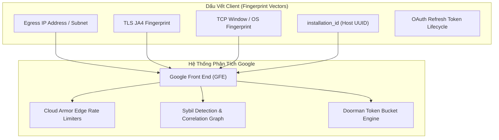

# Hướng Dẫn Kỹ Thuật: Phòng Ngừa Gắn Cờ & Khóa Tài Khoản (Anti-Abuse)

Tài liệu phân tích các cơ chế phát hiện lạm dụng (Abuse & Sybil Detection) của Google đối với dịch vụ Gemini / Code Assist / Antigravity và các biện pháp kỹ thuật giảm thiểu rủi ro của `agy-supervisor`.

---

## 1. Cơ Chế Giám Sát Của Google Front End (GFE) & Sybil Engine

Google áp dụng hệ thống phân tích đồ thị tương quan đa chiều (Multi-Dimensional Correlation Graph) để giám sát các tài nguyên API:



### Các thuật toán giám sát cốt lõi:
1. **SybilRank & EagleMine**: Phát hiện các cụm tài khoản (Identity Clusters) có hành vi phối hợp tự động để vượt qua chính sách giới hạn tài nguyên.
2. **Doorman / Bandwidth Engine**: Quản lý các Token Bucket trượt theo thời gian thực (RPM/RPD).
3. **Cloud Armor Rate Limiters**: Đếm tỷ lệ lỗi $\frac{4xx}{2xx}$ trong sliding window để kích hoạt CAPTCHA challenge hoặc IP Blackholing.

---

## 2. Các Dấu Hiệu Bất Thường (Red Flags) & Giải Pháp Kỹ Thuật

### 2.1 Cờ Đỏ 1: Hiện Tượng Đổi Tài Khoản Tức Thời (Fast Failover Anomaly: $t_{\Delta} < 50\text{ms}$)
* **Hiện tượng**: Khi Slot 1 nhận mã lỗi HTTP `429` (Rate Limit) ở thời điểm $T_0$, và Slot 2 lập tức gửi request nối tiếp ở $T_0 + 20\text{ms}$ trên cùng IP và TLS stack.
* **Đánh giá hệ thống**: Tần suất chuyển đổi profile quá nhanh và có tính chu kỳ cố định là dấu hiệu rõ ràng của kịch bản tự động lạm dụng quota (Bot / Sybil Heuristic trong `abuse.pi`).
* **Khắc phục trong `agy-supervisor`**:
  Supervisor áp dụng **Adaptive Handover Jitter** kết hợp độ trễ ngẫu nhiên phân phối đều và hàm mũ lùi an toàn:
  ```python
  # Phân tán mẫu truy vấn ngẫu nhiên từ 2.0s đến 5.0s
  base_jitter = random.uniform(2.0, 5.0)
  # Hàm mũ lùi an toàn theo số lần failover liên tiếp (kẹp k <= 10 chống tràn số)
  k = min(max(0, int(consecutive_failovers)), 10)
  backoff_multiplier = min(1.5 ** k, 10.0)
  total_jitter = min(base_jitter * backoff_multiplier, 30.0)
  time.sleep(total_jitter)
  ```
  Khoảng nghỉ ngẫu nhiên này phá vỡ hoàn toàn tương quan thời gian cơ học trên đồ thị của Sybil Engine, giả lập hành vi chuyển đổi người dùng tự nhiên.

---

### 2.2 Cờ Đỏ 2: Sinh Ngẫu Nhiên `installation_id`
* **Hiện tượng**: Tạo mới `installation_id` (UUID) mỗi khi hoán đổi tài khoản.
* **Đánh giá hệ thống**: `installation_id` thay đổi liên tục trong khi địa chỉ IP, hệ điều hành, TCP Window và TLS JA4 Fingerprint không đổi bị đánh giá là hành vi giả mạo phần cứng (Active Evasion Artifact).
* **Khắc phục trong `agy-supervisor`**:
  Supervisor **giữ nguyên một `installation_id` duy nhất** của máy trạm. Nhiều tài khoản Google trên cùng một máy phát triển là trường hợp sử dụng hợp lệ.

---

### 2.3 Cờ Đỏ 3: Bão Lỗi 4xx & Án Phạt Khóa Tài Khoản 56 Giờ (The 4xx Thrashing Storm)
* **Bằng chứng Pháp y thực tế (`cli-20261030_162823.log`)**:
  Trong phiên bản cũ, khi Slot 2 gặp lỗi cạn quota nhưng supervisor bị "mù" trước các mã thông báo của backend, hệ thống đã liên tục gửi lại yêu cầu dẫn đến **cơn bão 236 lỗi 4xx liên tiếp trong suốt 2.38 giờ**. Kết quả là hệ thống `abuse.pi` của Google đã áp dụng mức phạt khóa tài khoản lên tới **56 giờ 55 phút** đối với Slot 2.
* **Khắc phục trong `agy-supervisor`**:
  Hệ thống tích hợp **Bộ Ngắt Mạch Kép (Dual Circuit Breakers)**:
  1. **`ThrashingStormCircuitBreaker`**:
     Theo dõi cửa sổ trượt 60 giây. Nếu phát hiện $\ge 3$ lỗi 4xx liên tiếp, lập tức ngắt mạch sang trạng thái `OPEN` và áp dụng thời gian làm mát lùi hàm mũ: $60s \to 120s \to 240s$. Toàn bộ request bị chặn đứng trước khi máy chủ Google ghi nhận hành vi spam.
  2. **`RotationalBreaker`**:
     Nếu phát hiện $\ge 4$ lần xoay slot diễn ra trong vòng dưới 60 giây (dấu hiệu toàn bộ các tài khoản đều đang gặp trục trặc), supervisor tự động kích hoạt hãm phanh 30 giây để bảo vệ an toàn toàn bộ pool tài khoản.

---

### 2.4 Cờ Đỏ 4: Phân Biệt Lỗi Máy Chủ Quá Tải (HTTP 503 / UNAVAILABLE) Với Hạn Ngạch Tài Khoản
* **Hiện tượng**: Vào các khung giờ cao điểm, cụm server phục vụ model Gemini có thể bị quá tải và trả về mã lỗi HTTP 503 (`Service Unavailable: Model Overloaded` / `UNAVAILABLE: No capacity available for model... on the server`).
* **Phân tích bản chất**: Đây là hiện tượng tắc nghẽn hạ tầng của Google cho model cụ thể, hoàn toàn **không phải do tài khoản người dùng cạn kiệt quota**. `agy` đã tích hợp sẵn cơ chế retry lũy thừa (`run.go:389 ... retrying in 4s`), và thường thành công ngay ở attempt 2 hoặc 3.
* **Xử lý chuẩn xác trong `agy-supervisor`**:
  Supervisor tuyệt đối **không** coi 503 / UNAVAILABLE là lỗi cạn quota và không ngắt tiến trình giữa chừng khi `agy` đang retry. Điều này ngăn ngừa việc tài khoản bị đánh dấu nhầm thành `EXHAUSTED_DAILY` và loại bỏ hoàn toàn hiện tượng nhảy tài khoản oan (premature failover).

---

### 2.5 Cờ Đỏ 5: Mất Đồng Bộ Refresh Token (OAuth Token Desync)
* **Hiện tượng**: Google tự động làm mới `access_token` và `id_token` sau mỗi 45-60 phút và ghi vào `~/.gemini/oauth_creds.json`. Nếu supervisor không đồng bộ ngược lại slot archive, khi xoay vòng lại sẽ nạp token cũ đã hết hạn.
* **Khắc phục trong `agy-supervisor`**:
  Hàm `sync_back_current()` luôn được gọi trước mỗi lần hoán đổi slot và khi phiên kết thúc bình thường, đảm bảo token mới nhất luôn được lưu giữ an toàn.

---

### 2.6 Cờ Đỏ 6: Lệch Audience & Token Ngoại Lai (Foreign Audience Contamination)
* **Hiện tượng**: Người dùng cấu hình tài khoản bằng token được sinh ra từ các công cụ khác (như `@google/gemini-cli` với Client ID `681255809395`).
* **Đánh giá của hệ thống xác thực Google**:
  Mỗi ứng dụng chính thức của Google được cấp một cặp Client ID & Client Secret riêng biệt. Khi `agy` (Client ID `1071006060591`) cố gắng dùng credentials của mình để refresh một refresh token được cấp cho `gemini-cli`, endpoint OAuth của Google lập tức trả về mã lỗi `HTTP 401 unauthorized_client`. Nếu lặp lại nhiều lần, tài khoản sẽ bị gắn cờ nghi ngờ gian lận (Account Notice) và bị đình chỉ tạm thời.
* **Khắc phục trong `agy-supervisor`**:
  Tích hợp bộ phòng thủ **`AudienceValidator` (Client ID Guard)**:
  - Tự động bóc tách claim `aud` và `azp` từ JWT `id_token` trong file credentials trước khi nạp vào phiên làm việc.
  - Nếu phát hiện token ngoại lai (như `681255809395`), supervisor lập tức gán trạng thái `CLIENT_ID_MISMATCH`, in cảnh báo hướng dẫn người dùng chạy `agy-supervisor login <N>` để đăng nhập lại đúng chuẩn Antigravity, và **tuyệt đối không cho phép slot này kích hoạt** trong luồng xoay tua tự động.

---

### 2.7 Cờ Đỏ 7: Liên Đới Dữ Liệu Phiên & Quét Dấu Vết Trajectory (Cross-Slot Trajectory Correlation)
* **Hiện tượng**: Khi chuyển từ Slot 1 sang Slot 2 nhưng vẫn dùng chung nguyên vẹn file cơ sở dữ liệu `state.vscdb` và giữ nguyên Conversation ID / Trajectory UUID cũ của Slot 1.
* **Đánh giá của hệ thống Telemetry Google (`abuse.pi`)**:
  Phân tích đồ thị telemetry sẽ phát hiện: hai tài khoản người dùng khác nhau đang cùng gửi các tin nhắn nối tiếp trên cùng một chuỗi Trajectory ID duy nhất từ cùng một fingerprint máy trạm. Đây là dấu hiệu cơ học chứng minh một cá nhân đang điều khiển nhiều tài khoản để lách quota.
* **Khắc phục trong `agy-supervisor`**:
  Cơ chế **`fork_conversation()`**:
  - Sao chép SQLite an toàn qua URI Read-Only và API `src_conn.backup(dst_conn)`, đảm bảo toàn vẹn cả file WAL và SHM.
  - Tự động sinh mới UUID cho nhánh trò chuyện của tài khoản mới trong cơ sở dữ liệu trước khi bàn giao.
  - Cắt đứt hoàn toàn chuỗi tương quan đồ thị giữa các slot tài khoản, bảo vệ tính độc lập của từng hồ sơ người dùng.

---

## 3. Phân Biệt Quota Phút (RPM) Và Quota Ngày (RPD)

| Tiêu chí | Quota Phút (RPM / TPM) | Quota Ngày (RPD / TPD) |
| :--- | :--- | :--- |
| **Bản chất** | Giới hạn tốc độ gửi tin nhắn trong 1 phút | Hạn mức sử dụng token/request tối đa trong ngày |
| **Thời gian phục hồi** | **30–60 giây** (hồi phục theo bucket) | **Reset vào 00:00 PST/PDT (khoảng 14:00/15:00 giờ VN)** |
| **Mã lỗi trả về** | HTTP 429 (`rateLimitExceeded`) | HTTP 429 (`Individual quota reached. Resets in XhYm`) |
| **Chiến lược xử lý** | Giữ phiên, nghỉ 30-60s | Chuyển ngay sang tài khoản tiếp theo trong pool |

`agy-supervisor` tính toán chính xác thời điểm reset quota theo múi giờ `America/Los_Angeles` (00:05 PST ngày hôm sau) có xử lý Daylight Saving Time (DST) để quản lý trạng thái `EXHAUSTED_DAILY`, không bao giờ xoay lại các tài khoản đã hết quota ngày trước giờ reset.
