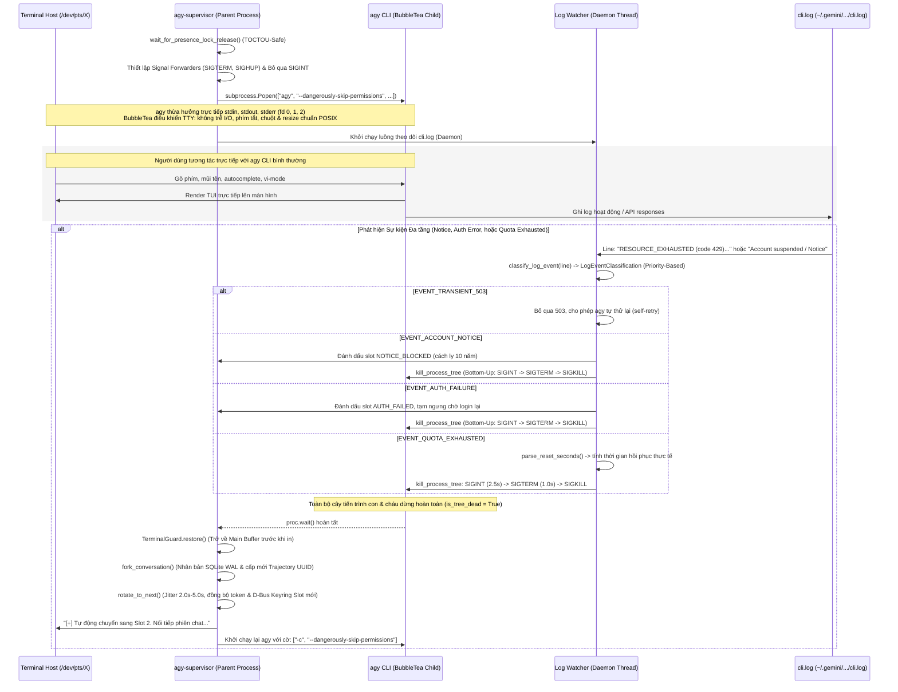

# Architecture & Systems Engineering Deep-Dive

Tài liệu này phân tích chi tiết cấu trúc kỹ thuật tầng thấp (Low-Level Systems Engineering), cơ chế giao tiếp liên tiến trình (IPC), nhân Linux TTY, và chiến lược xử lý dữ liệu của `agy-supervisor`.

---

## 1. Mô Hình Thực Thi TTY & Quản Lý Tín Hiệu (Linux Kernel & Terminal Execution)

### 1.1 Phân Tích Kỹ Thuật Khi Bọc TUI Qua PTY Proxy Hoặc Subprocess
Antigravity CLI (`agy`) sử dụng framework giao diện TUI **BubbleTea** (viết bằng Go). Khi BubbleTea khởi động:
1. Đưa terminal vào chế độ **Raw Mode**: xóa các cờ `ICANON` (không chờ phím Enter), `ECHO` (không tự in ký tự gõ), và `OPOST` (xử lý output thủ công).
2. Phát chuỗi ANSI **`\x1b[?1049h` (`smcup`)** để chuyển toàn bộ màn hình sang Alternate Screen Buffer, và **`\x1b[?25l`** để ẩn con trỏ chuột.

Khi xây dựng trình giám sát (Supervisor), có hai lỗi kiến trúc phổ biến:
* **PTY Proxy thiếu cấu hình raw mode**: Nếu mở một PTY master/slave nhưng không đặt `sys.stdin` của tiến trình cha vào raw mode (`tty.setraw()`), driver TTY của hệ điều hành vẫn ở chế độ canonical (cooked mode). Toàn bộ phím gõ, mũi tên điều hướng, autocomplete sẽ bị đóng băng hoặc in ra ký tự rác (`^[[A`) cho đến khi bấm Enter. Việc dùng vòng lặp `select.select()` ở tiến trình cha còn tạo ra độ trễ I/O và gây lỗi desync kích thước màn hình (`SIGWINCH`).
* **Tiến trình con bị đẩy vào Background (`SIGTTIN` / `SIGTTOU`)**: Nếu chạy `agy &` trong background, nhân Linux sẽ gửi tín hiệu **`SIGTTIN`** hoặc **`SIGTTOU`**, lập tức dừng tiến trình.

### 1.2 Kiến Trúc Tối Ưu: Direct Foreground Execution + Daemon Log Watcher
`agy-supervisor` áp dụng mô hình thực thi trực tiếp trên Foreground TTY kết hợp luồng giám sát ngầm:



### 1.3 Triệt Tiêu Cây Tiến Trình Con Cháu & Chống Zombie (kill_process_tree & is_tree_dead)
Nếu child process spawn thêm các tiến trình cháu (grandchildren) hoặc chạy nền, việc chỉ gửi tín hiệu cho process cha sẽ để lại các tiến trình mồ côi (orphans/zombies) tiếp tục chiếm giữ presence lock. Đồng thời, nếu gửi `os.killpg()` nhầm vào Process Group của chính Supervisor, Supervisor sẽ vô tình tự hủy (process self-kill).

Để giải quyết triệt để cả hai vấn đề, `agy-supervisor` áp dụng cơ chế:
1. **Cô lập Process Group**: Sử dụng `preexec_fn=os.setsid` khi `subprocess.Popen` để tiến trình con trở thành Session Leader riêng biệt.
2. **Thuật toán quét sống chết toàn cây (`is_tree_dead`)**: Duyệt ngược từ dưới lên (Bottom-Up) và tích lũy danh sách `known_descendants`.
3. **Thang leo thang tín hiệu 3 cấp độ**:
```python
# Thuật toán kill_process_tree:
def kill_process_tree(proc, timeout=3.0):
    # 1. Gửi SIGINT cho toàn bộ Session Group con
    os.killpg(child_pgid, signal.SIGINT)
    # 2. Polling kiểm tra is_tree_dead()
    if not is_tree_dead(child_pgid, known_descendants, timeout=2.5):
        # 3. Leo thang sang SIGTERM
        os.killpg(child_pgid, signal.SIGTERM)
        if not is_tree_dead(child_pgid, known_descendants, timeout=1.0):
            # 4. Cưỡng chế ngắt bằng SIGKILL
            os.killpg(child_pgid, signal.SIGKILL)
```

Đồng thời, tiến trình cha đăng ký forwarder cho `SIGTERM` và `SIGHUP` để không bao giờ để lại tiến trình con mồ côi (orphan process) khi terminal bị tắt.

### 1.4 Phục Hồi Bộ Đệm Màn Hình An Toàn (`TerminalGuard`)
Class `TerminalGuard` lưu cấu hình `termios` gốc trước khi khởi chạy và phát chuỗi escape phục hồi chuẩn ANSI:
```python
def restore(self):
    if self.is_tty and self.orig_termios:
        try:
            termios.tcsetattr(sys.stdin.fileno(), termios.TCSANOW, self.orig_termios)
        except Exception:
            pass
    if sys.stdout.isatty():
        # Thoát Alternate Screen Buffer (\x1b[?1049l), hiện con trỏ (\x1b[?25h), tắt chuột & bracketed paste
        sys.stdout.write("\x1b[?1049l\x1b[?25h\x1b[?1000l\x1b[?1002l\x1b[?1006l\x1b[?2004l\r\n")
        sys.stdout.flush()
```
> [!IMPORTANT]
> `guard.restore()` luôn được gọi **trước** khi in thông báo xoay tua hoặc Circuit Breaker. Nếu in khi đang ở Alternate Screen Buffer của BubbleTea, thông báo sẽ bị cuốn trôi ngay khi buffer bị đóng lúc tiến trình thoát.

---

## 2. Engine Đọc Log Streaming & Xử Lý Cắt Khúc Ranh Giới (Line-Buffered Watcher)

### 2.1 Xử Lý Ranh Giới Chunk Khi Đọc Stream (Chunk Boundary Slicing)
Khi đọc stream từ file descriptor bằng `read(cur_size - tracked_pos)`, các chunk byte được trả về theo buffer của hệ điều hành. Nếu một chuỗi quan trọng như `RESOURCE_EXHAUSTED` bị cắt đôi ở ranh giới giữa hai chunk:
- Chunk 1 kết thúc bằng: `... failed (RESOUR`
- Chunk 2 bắt đầu bằng: `CE_EXHAUSTED (code 429) ...`

Nếu kiểm tra từng chunk độc lập mà không ghép dòng, cả hai lần đọc đều trả về `False` (bỏ lọt sự kiện cạn quota).
`agy-supervisor` triển khai bộ đệm dòng (`line_buffer`):
```python
content = line_buffer + new_bytes
lines = content.split(b"\n")
line_buffer = lines.pop() # Giữ lại phần dòng chưa hoàn thiện cho lần đọc sau

for line in lines:
    classification = classify_log_event(line)
    if classification.event != LogEvent.EVENT_NONE:
        # Xử lý theo thứ bậc ưu tiên: NOTICE > AUTH > QUOTA > TRANSIENT
        ...
```

### 2.2 Xử Lý Đồng Thời Trong Go (Go Concurrency Masking)
File log của `agy` ghi nhận hai Goroutine chạy song song:
```text
I0913 12:57:14.237128   28527 run.go:387] Run: attempt 1 failed (RESOURCE_EXHAUSTED (code 429): Individual quota reached. Resets in 4h46m23s.)
I0913 12:57:14.294501   28527 quota_manager.go:41] doRefreshQuota: skipped (throttled)
```
Dòng `doRefreshQuota: skipped (throttled)` xuất hiện chỉ **57ms** sau dòng báo lỗi hạn ngạch. Nếu kiểm tra false-positive trên toàn bộ khối chunk, dòng throttled sẽ vô hiệu hóa dòng lỗi quota thực sự.
`agy-supervisor` phân tách theo từng dòng (`line-by-line`) để đảm bảo không một dòng log định kỳ nào có thể che giấu sự kiện cạn kiệt quota.

### 2.3 Quản Lý Truncate & Rotation In-Place
Nếu log file bị xóa hoặc thu nhỏ (`> cli.log`), `cur_size < tracked_pos`. Supervisor tự động phát hiện tình trạng file bị thu nhỏ và lập tức reset `tracked_pos = 0`, ngăn ngừa tình trạng "mù" log.

---

## 3. Đồng Bộ D-Bus Secret Service (GNOME Keyring)

### 3.1 Cơ Chế Lưu Token Của Thư Viện `go_keyring`
Nhị phân `agy` tích hợp thư viện Go `github.com/zalando/go_keyring`. Trên Linux Desktop:
1. `agy` lưu trữ token đăng nhập trong GNOME Keyring với định danh:
   - **Service**: `gemini`
   - **Username**: `antigravity`
   - **Schema**: `org.freedesktop.Secret.Generic`
2. **Thứ Tự Ưu Tiên**: Khi khởi động, `agy` kiểm tra GNOME Keyring **trước**. Nếu tìm thấy token trong Keyring, nó sẽ bỏ qua file `~/.gemini/oauth_creds.json`.

### 3.2 Giải Pháp In-Place Update Thay Vì Tạo Trùng Lặp
Thay vì gọi `CreateItem` có thể gây tràn/nhân bản mục trong Keyring trên một số bản phân phối Linux:
1. Supervisor kiểm tra xem mục `service=gemini, username=antigravity` đã tồn tại chưa bằng `get_keyring_item(bus)`.
2. Nếu đã tồn tại: gọi phương thức D-Bus `item_obj.SetSecret(...)` để cập nhật trực tiếp tại chỗ (In-place Update).
3. Nếu chưa tồn tại: mở collection và tạo mới với `CreateItem(..., replace=True)`.
4. Hỗ trợ dự phòng đường dẫn collection: thử `/org/freedesktop/secrets/aliases/default` trước, nếu thất bại sẽ fallback sang `/org/freedesktop/secrets/collection/login`.

---

## 4. Quản Lý File Lock & Cơ Sở Dữ Liệu SQLite WAL

### 4.1 Presence Advisory Lock
Mỗi phiên làm việc của `agy` giữ một file lock advisory qua `flock`:
```text
~/.gemini/antigravity-cli/presence/<conversation_id>.lock
```
Nếu tiến trình `agy -c` mới được spawn trước khi kernel dọn xong file descriptor của tiến trình cũ, tiến trình mới sẽ bị từ chối truy cập. Supervisor sử dụng hàm `wait_for_presence_lock_release(timeout=3.0)` với cơ chế bắt ngoại lệ `FileNotFoundError` (chống TOCTOU race condition) để chờ lock được giải phóng hoàn toàn.

### 4.2 SQLite WAL Checkpointing
Cơ sở dữ liệu lưu trữ lịch sử hội thoại `conversation_summaries.db` và `conversations/<uuid>.db` hoạt động ở chế độ Write-Ahead Logging (`-wal` và `-shm`). Việc gửi `SIGINT` trước khi ngắt giúp tiến trình Go flush toàn bộ WAL frame xuống database chính và đóng kết nối an toàn, loại bỏ hoàn toàn nguy cơ gặp lỗi `database is locked` (`SQLITE_BUSY`).

---

## 5. Tính Toàn Vẹn Dữ Liệu (Atomic State Persistence)

Tất cả các thay đổi trạng thái trong `supervisor_state.json` đều tuân thủ nguyên tắc ghi nguyên tử:
1. Dữ liệu JSON được ghi ra file tạm `.tmp`.
2. Gọi `f.flush()` và ép xả xuống phiến đĩa vật lý bằng `os.fsync(f.fileno())`.
3. Thay thế file đích bằng hàm POSIX `os.replace(tmp_file, target_file)`.

Cơ chế này bảo đảm `supervisor_state.json` không bao giờ rơi vào trạng thái 0 bytes hoặc JSON hỏng nếu máy tính bị sập nguồn đột ngột.

---

## 6. Pipeline Lọc Tham Số Dòng Lệnh Khi Nối Tiếp Phiên

Khi chuyển từ phiên thông thường sang phiên nối tiếp (`is_continue = True`):
1. Cờ `--dangerously-skip-permissions` luôn được bảo đảm chèn vào danh sách lệnh.
2. Cờ `-c` được chèn vào đầu để kích hoạt chế độ continue.
3. Các cờ cấu hình môi trường chạy kèm giá trị (`--model`, `-m`, `--effort`, `-e`, `--agent`, `-a`, `--project`, `--mode`, `--add-dir`, `--conversation`) được bảo lưu toàn vẹn.
4. Các cờ thực thi prompt một lần (`-p`, `--print`, `--prompt`, `-i`, `--prompt-interactive`) được lược bỏ sạch sẽ, tránh hiện tượng prompt cũ bị gửi lặp lại trong phiên chat mới.

---

## 7. Động Cơ Phân Loại Sự Kiện Đa Tầng (Notice & Event Classification Engine)

Để loại trừ hoàn toàn hiện tượng "Notice Blindness" (mù trước lỗi vi phạm điều khoản dẫn đến bão 236 request lỗi và khóa tài khoản 56 giờ), `classify_log_event(line)` thực thi bộ phân loại theo thứ tự ưu tiên nghiêm ngặt:

1. **`EVENT_ACCOUNT_NOTICE`**:
   - Khớp các chữ ký nghiêm trọng: `account.*suspended`, `terms of service violation`, `account temporarily disabled`, `ineligible tier`.
   - Hành vi: Đánh dấu slot `NOTICE_BLOCKED`, thiết lập thời gian hạ nhiệt cách ly 10 năm (`315360000s`), dừng ngay lập tức việc retry trên slot này để bảo vệ tài khoản.
2. **`EVENT_AUTH_FAILURE`**:
   - Khớp các mã lỗi: `HTTP 401 Unauthorized`, `unauthorized_client`, `token revoked`, `invalid_grant`, `HTTP 403 Forbidden` (do credential).
   - Hành vi: Đánh dấu slot `AUTH_FAILED`, tạm dừng xoay tua trên slot này cho đến khi người dùng đăng nhập lại qua `agy-supervisor login <N>`.
3. **`EVENT_QUOTA_EXHAUSTED`**:
   - Khớp: `HTTP 429 Too Many Requests`, `RESOURCE_EXHAUSTED`, `Individual quota reached`, `rate limit exceeded`.
   - Hành vi: Trích xuất `reset_seconds` chính xác từ payload phản hồi hoặc thời gian reset Pacific Midnight, đánh dấu `EXHAUSTED_DAILY` và chuyển sang slot tiếp theo.
4. **`EVENT_TRANSIENT_503`**:
   - Khớp: `HTTP 503 Service Unavailable`, `model overloaded`, `no capacity available on the server`.
   - Hành vi: Không ngắt tiến trình, cho phép cơ chế retry nội bộ của `agy` tự khắc phục mà không đánh giá nhầm tài khoản bị cạn hạn ngạch.

---

## 8. Kiến Trúc Bộ Ngắt Mạch Kép Chống Bão Lỗi (Dual Circuit Breakers)

### 8.1 Thrashing Storm Circuit Breaker (`ThrashingStormCircuitBreaker`)
- **Mục tiêu**: Ngăn chặn tình trạng spam request dồn dập khi các tài khoản liên tục gặp lỗi 4xx.
- **Cơ chế**:
  - Áp dụng cửa sổ trượt (Sliding Window) 60 giây.
  - Nếu số lỗi liên tiếp đạt ngưỡng $\ge 3$ lỗi, mạch chuyển sang trạng thái `OPEN`.
  - Áp dụng thời gian làm mát lùi hàm mũ (Exponential Backoff): $60s \to 120s \to 240s$ (tối đa 3600s).
  - Trạng thái ngắt mạch được lưu trữ bền vững trong `circuit_breaker_state.json` và đồng bộ qua khóa luồng `threading.RLock()`.

### 8.2 Rotational Circuit Breaker (`RotationalBreaker`)
- **Mục tiêu**: Ngăn chặn vòng lặp quay vòng slot quá nhanh khi tất cả các tài khoản đều không thể phục vụ.
- **Cơ chế**: Nếu hệ thống thực hiện $\ge 4$ lần chuyển đổi slot trong vòng dưới 60 giây, Supervisor sẽ tự động kích hoạt hãm phanh an toàn 30 giây và cảnh báo người dùng.

---

## 9. Cách Ly Phiên SQLite WAL & Tách Biệt Trajectory (Session Lineage Isolation)

Khi chuyển giao phiên chat từ Slot cũ sang Slot mới:
1. **URI Read-Only & Online Backup**: Để tránh lỗi khóa database (`SQLITE_BUSY`) hoặc xung đột file `-wal`/`-shm`, Supervisor mở database gốc với cờ `file:{src_db}?mode=ro` và sử dụng API SQLite Online Backup `src_conn.backup(dst_conn)`.
2. **Atomic Promotion**: Đẩy cơ sở dữ liệu đã clone vào vị trí đích bằng hàm POSIX nguyên tử `os.replace()`.
3. **Trajectory UUID Regeneration**: Tự động sinh mới UUID cho chuỗi hội thoại của slot mới trong bảng `conversations`, ngăn chặn thuật toán phân tích hành vi của Google phát hiện sự liên kết giữa các phiên của các tài khoản khác nhau trên cùng một máy.

---

## 10. Kiểm Thực Khán Giả Token & Thăm Dò Sức Khỏe Slot (`AudienceValidator` & `SlotHealthProber`)

### 10.1 Audience Validator & Client ID Guard
- Giải mã payload JWT `id_token` mà không cần secret key, trích xuất trường `aud` (Audience) và `azp` (Authorized Party).
- Đối chiếu với bộ Client ID hợp lệ của Antigravity CLI:
  - Consumer Client ID: `1071006060591-...`
  - Enterprise GCP Client ID: `884354919052-...`
- Nếu phát hiện token ngoại lai (ví dụ `681255809395` từ `@google/gemini-cli`), hệ thống sẽ gán trạng thái `CLIENT_ID_MISMATCH`, in hộp cảnh báo chi tiết và tự động bỏ qua slot này trong luồng xoay tua để bảo vệ tài khoản.

### 10.2 Slot Health Prober Out-of-Band
- Cho phép kiểm tra trạng thái token và quota mà không tiêu hao prompt token của người dùng.
- Kết nối trực tiếp tới các endpoint nội bộ của Google CloudCode:
  - `POST /v1internal:loadCodeAssist`
  - `POST /v1internal:retrieveUserQuota`
- Phân biệt rõ ràng giữa lỗi mạng tạm thời (HTTP 500/503 $\to$ `NETWORK_ERROR`) và lỗi xác thực vĩnh viễn (HTTP 401 $\to$ `TOKEN_REVOKED`). Xử lý an toàn các ngoại lệ `JSONDecodeError` và áp mức sàn làm mát tối thiểu 1 giờ nếu timestamp reset bị âm hoặc lỗi thời.
